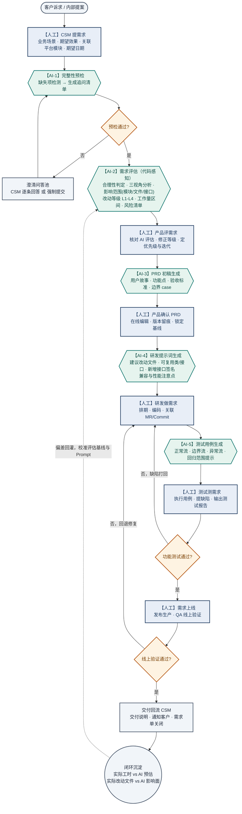
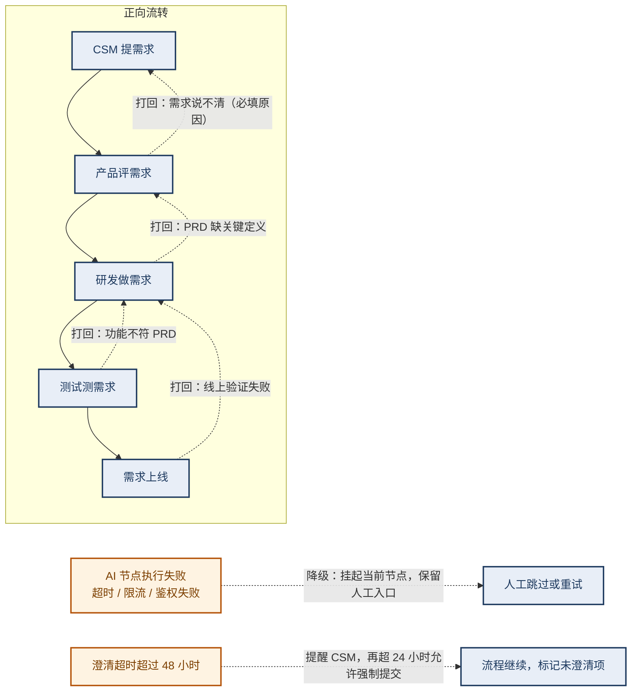

# 企业级需求 SOP 落地系统 · PRD v0.5（草案）

> 版本：v0.5 草案 · 产出人：许清楚（产品经理） · 日期：2026-08-04
> 定位：在 v0.4 已有实现基础上，补齐**闭环流程定义**、**AI 节点能力契约**、**一期收尾范围**三块空白。
> 本文档不覆盖 v0.4 已冻结的技术设计（数据模型 / API / 状态机），只做增量与修正，需与 `AI-SOP需求管理系统-PRD.md` 配套阅读。

---

## 0. 需求再定义（先纠偏，再动手）

主理人下发的三句话诉求是**方案描述**，不是问题描述。拆解后真实问题如下：

| 用户说的 | 背后真正的问题 | 判断依据 |
|---|---|---|
| "完善 PRD，要有闭环流程图" | 现有 PRD 用 ASCII 画流程，节点职责、打回路径、AI 介入点没有单一权威定义，导致开发时每个人脑子里的流程不一样 | 现有 PRD 第 5 节为纯文本流程，全文 0 处 mermaid；`engine.js` 的 `sendBack` 只能退一格，与文档描述的"任意下游可打回上游"不一致 |
| "中间嵌入 AI 节点帮忙分析、给建议" | AI 节点已经存在，但输出的是**通用套话**（"实现路径清晰，主要涉及后端接口与前端展示两层"），产品和研发不会采纳，SOP 会退化成走过场的审批流 | `ai.js` 中 `mockEvaluate` 的 `perspectives` 为固定模板串；工作量估算 `mockEvaluate` 用 `desc.length` 判定 L1-L4，与需求复杂度无关 |
| "接真实 LLM + GitLab 快照" | 让 AI 的建议**可被验证**——说影响哪个文件，就要能点开那个文件 | `buildCodeContext` 已实现但仅注入目录树，评估报告 `impact_scope.files` 目前回填的是 `'(基于目录结构推断,详见 code_context)'` 占位串 |

**结论**：本轮的成功标准不是"接通了 LLM"，而是 **AI 产物被下游角色采纳的比例**。接通 API 只是必要条件。

**核心指标（North Star）**：AI 评估采纳率 = 产品在评审时未推翻 AI 给出的改动等级(L1-L4)与影响模块的比例。目标 ≥ 60%。

---

## 1. 产品定义

**一句话定义**：把「CSM 提需求 → 产品评需求 → 研发做需求 → 测试测需求 → 需求上线」这条企业交付链路固化成可配置 SOP，并在每个交接口嵌入**读得到真实代码**的 AI 节点，用于降低需求返工与评估口径分歧。

**产品边界**：
- 是：面向**内部交付链路**的需求流转与 AI 辅助决策系统（私有化部署，代码只读不外传第三方 SaaS）
- 不是：通用项目管理工具（不做甘特图、资源日历、工时结算）
- 不是：AI 编码工具（不生成可提交的代码，只生成喂给 Cursor / Claude Code 的结构化提示词）

---

## 2. 目标用户与角色画像

### 2.1 主要用户

**画像 A：CSM / 客户成功经理（需求发起方）**
- 28-35 岁，非技术背景，日常对接 3-15 家客户
- 场景：客户在会议里提了一句"能不能加个批量导出"，CSM 需要把它变成研发能接的需求单
- 痛点排序：① 不知道要写清楚哪些信息，提完被研发追问 3 轮 ② 提完就石沉大海，客户追进度时答不上来 ③ 不理解"这个改动要 8 人日"的依据，无法向客户解释
- 技术水平：会用表单和看板，不会看代码，不接受需要培训才能用的界面
- 成功感受：提单时系统当场告诉他"缺了什么"，而不是三天后被打回

**画像 B：产品经理 / PO（需求裁决方）**
- 26-38 岁，同时在管 5-20 条需求
- 场景：收到 CSM 的需求，要判断做不做、多大、排哪个迭代，然后写 PRD
- 痛点排序：① 评估工作量靠拍脑袋，不同人口径差 3 倍 ② 写 PRD 的 60% 时间花在抄背景和补边界 case ③ 判断"这个需求跟已有功能冲不冲突"要去问研发
- 成功感受：AI 给的影响面能点开看到真实文件，评估有据可依而不是猜

**画像 C：研发工程师 RD（需求实现方）**
- 24-35 岁，手上同时挂 2-5 个需求
- 场景：拿到 PRD 后自己扒代码找改哪里
- 痛点排序：① PRD 只有业务描述没有技术上下文，要自己找入口 ② 需求边界模糊，做到一半发现理解错 ③ 反复向产品确认细节，打断心流
- 成功感受：拿到的研发提示词能直接粘进 Cursor / Claude Code 开工

### 2.2 次要用户

**画像 D：测试工程师 QA** — 痛点是用例靠手写、容易漏边界与回归点；期望拿到带回归范围提示的用例初稿。

**画像 E：研发负责人 / CTO（决策者、掏钱的人）** — 关心的不是功能，是"需求卡在哪个环节、平均流转多久、返工率多少"。他决定这套系统是否推广，但他不是日常用户。

**画像 F：系统管理员** — 配置 GitLab 凭证、LLM Provider、SOP 模板、平台模块映射。人数 1-2 人，但配置错了全员受影响，所以配置项必须有连通性自检。

---

## 3. 竞品分析

### 3.1 行业基线（引自 references/industries/enterprise.md）
- 企业管理类产品核心诉求：流程标准化、数据可视化、权限分级、审批流转
- 配色基线：深蓝/藏青主色 + 琥珀色告警，禁紫粉渐变，禁 emoji 做功能图标
- 布局基线：左侧导航 + 顶部面包屑 + 右侧内容区；审批流用可视化流程图 + 节点状态标记
- AI 架构基线：权限感知 Function Calling（LLM 只看得到有权使用的工具）

### 3.2 直接竞品

| 竞品 | 核心功能 | 优势 | 劣势（来自差评与实测评价） | 定价 |
|---|---|---|---|---|
| **PingCode** | 研发全生命周期，需求→测试全流程，PingCode AI 辅助写需求 | 对标 Jira 的完整敏捷体系；OKR + 效能度量；本土化服务好；25 人内免费 | AI 停留在"IDE 插件、辅助写需求"层面，与流程本身耦合度低；跨组织/跨法人权限需额外项目隔离方案；非研发角色卷入多时"研发属性显得偏专" | 25 人内免费；付费约 ¥40-70/人/月；私有部署 26 人起购，另议 |
| **TAPD（腾讯）** | 敏捷研发协作，双工作流引擎，AI 周报，深度对接企微/腾讯云 | 双流程引擎（状态机 + 多分支节点）灵活；自动化规则编排成熟；微信团队等大规模实战验证 | 强绑腾讯生态；专业版自定义字段仅 10 个/项目、保密需求 100 个/项目；AI 偏内容生成（周报/摘要），不参与流程裁决 | 专业版免费（≤30 人）；卓越版 ¥499/人/年；企业版 ¥799/人/年；私有部署另议 |
| **飞书项目** | 项目协作 + AI 节点 + MCP + CLI，AI 可作为流程节点嵌入审批流 | **最接近本产品形态**：AI 节点可嵌入审批流做变更影响摘要；MCP 让 Agent 调用项目数据；CLI 可脚本化；字段级/视图级权限 | 强绑飞书生态，非飞书企业落地成本高；AI 节点分析基于**工单文本**而非代码，影响面判断不可验证；私有化能力弱 | 免费版可用；企业版约 ¥30-60/人/月 |
| **ONES** | 研发管理 + ONES Assistant + MCP Server，权限边界内的 Agent | 私有化部署 + 信创合规能力强；测试与质量管理有优势；Agent 在真实对象和权限边界内运行 | 从"流程驱动"转向"数据/AI 驱动"时需**额外搭建分析与 AI 集成层**；AI 定位为既有流程的"智能增强组件"，不是流程本身 | 企业版 SaaS ¥7200 起（10 人起）；私有部署咨询 |
| **Jira + Atlassian Intelligence / Rovo** | 全球标准敏捷工具 + AI 摘要、智能分派、PR 描述生成 | 生态最深（3000+ 插件）；组织级知识图谱；Rovo Dev 已切入代码生成 | 学习曲线陡峭需专职管理员；UI 被评价"老旧笨重"；**AI 被评价为"retrofitted 而非 AI-first"**；AI 锁在 Premium（$16-18.3/user/mo）；**Data Center/本地部署完全用不了 AI，必须迁云** | Standard $8.15-9.05/user/mo；Premium $16-18.3/user/mo；Rovo Dev $20/dev/mo |

### 3.3 间接替代方案

| 替代方案 | 用户为什么用它 | 它解决不了什么 |
|---|---|---|
| **企微群 + 飞书文档 + Excel 需求池** | 零成本、零学习、想改就改；中小团队实际最常用的方案 | 无流转约束，需求靠人催；无留痕，扯皮时查不到；无任何评估辅助 |
| **GitHub Issue / GitLab Issue + Cursor / Claude Code** | 研发侧 AI 直接读真实代码，实现指引质量最高 | 只服务研发一个角色；CSM 和产品进不来；没有 SOP 与角色交接约束 |
| **ChatPRD 等单点 AI 写 PRD 工具** | 单点体验好，PRD 初稿快 | 与需求流转、代码、测试完全脱节；产出是孤立文档，无版本与留痕 |
| **GitLab Duo** | 与代码同源，Issue 到代码链路顺 | 面向研发工作流，无 CSM/产品/测试的多角色 SOP 编排 |
| **代码理解类工具（GitNexus / DevSeerAI / JoyCode 类）** | 读代码做影响面分析、复杂度评分，准确度高 | 无流程、无角色、无需求单；是"工具"不是"系统"，管理者看不到交付链路状态 |

### 3.4 市场空白（差评交叉分析得出）

三类工具各占一角，**三者交集为空**：

```
        流程节点级 AI（AI 是节点，不是按钮）
                    ▲
         飞书项目 ●  │
                    │
   ─────────────────┼─────────────────▶ 真实代码上下文
                    │        ● GitNexus / DevSeerAI / Cursor
        PingCode ●  │        ● GitLab Duo
        TAPD/Jira ● │
                    ▼
              私有化可控（代码不出域）
                    ● ONES / TAPD 私有版（但 AI 不读代码）
```

三条来自差评的一致信号：
1. **"AI 写需求"不是刚需，"AI 能不能嵌进我的工作流"才是**（智驾团队横评原话）——竞品普遍把 AI 做成"助手按钮"，用户要主动点，流程不依赖它
2. **AI 输出不可验证 → 不被信任**：竞品 AI 基于工单文本推断影响面，产品和研发无法核验，最终只当摘要用
3. **私有化与 AI 二选一**：Jira Data Center 完全无 AI；国产私有版 AI 能力显著弱于其 SaaS 版

---

## 4. 我们的差异化

**定位一句话**：唯一一个把「AI 当作 SOP 流程节点」× 「AI 读得到私有 GitLab 真实代码」× 「全私有化部署」三者同时做到的需求交付系统。

三条可验证的差异点：

| 差异点 | 竞品做法 | 我们的做法 | 用户可感知的差别 |
|---|---|---|---|
| AI 的位置 | 侧边栏助手按钮，用户主动点 | AI 是 SOP 节点，需求流转到该节点**自动执行**，可阻断流程（预检不过则挂起追问） | 需求质量在入口就被卡住，而不是流到研发才发现说不清 |
| AI 的输入 | 工单标题 + 描述文本 | 工单文本 **+ 关联平台模块的 GitLab 代码快照**（目录树 + 关键文件内容） | 影响面报告写"改动集中在 `OrderController.java`"，产品可以点开核验 |
| 部署与数据 | AI 能力普遍绑 SaaS；私有化版本 AI 阉割 | 全私有化：代码快照落本地 `server/data/repos/`，LLM 网关可对接企业内部网关/自建模型 | 金融、政企场景下代码不出域仍可用 AI |

**用户为什么选我们而不是竞品**：如果团队已经有 TAPD/Jira 且只需要"记录流程"，不应该选我们。选我们的唯一理由是——**需要 AI 给出的评估结论有代码依据、且代码不能出企业内网**。这是一个窄但真实的场景。

---

## 5. 核心闭环流程图

### 5.1 主流程（正常路径 + AI 节点）



**图例**：深蓝底 = 人工节点（由该节点负责角色本人操作，后端强制校验）；墨绿底 = AI 节点（自动执行）；琥珀底 = 判定网关；灰底 = 起止与旁路。

### 5.2 打回与异常路径



**打回规则修正（相对 v0.4）**：现有 `engine.js::sendBack` 只支持退回**上一格**。按上表，打回目标应可指定为任一上游人工节点（如测试直接打回产品），且跳过中间的 AI 节点不重复执行。此为本轮需修正项。

---

## 6. AI 节点能力定义（契约）

每个 AI 节点必须明确五件事：输入、输出结构、可阻断性、失败降级、人工干预点。缺任何一项都会导致上线后出现"AI 卡死流程"或"AI 输出没人看"。

| 节点 | 输入 | 输出（结构化） | 可否阻断流程 | 失败降级 | 人工干预点 |
|---|---|---|---|---|---|
| **AI-1 完整性预检** | 需求标题 + 描述 + 关联模块 | `{pass, issues[], questions[], summary}` | **可**：不通过则挂起为待澄清 | LLM 失败 → 规则引擎兜底（关键词与长度检测）→ 仍失败则放行并标记"未预检" | CSM 可对每个问题回答，或"强制提交"跳过（留痕） |
| **AI-2 需求评估** | 需求全文 + 澄清答案 + **代码上下文（目录树）** | `{rationality, perspectives{customer,product,engineering}, impact_scope[{module,files[],apis[],confidence}], level, effort{min_days,max_days,confidence,basis}, risks[]}` | **可**：verdict=NEED_CLARIFY 时挂起 | 降级为不含代码上下文的文本评估，并在报告头部标注"未使用代码上下文，置信度下调" | 产品可修改 level 与 effort，修改被记录为偏差样本 |
| **AI-3 PRD 生成** | 需求 + 评估报告 + PRD 模板 | Markdown（含用户故事 / 功能点表 / AC / 边界 case / Out-of-Scope） | **否**：仅生成初稿 | 输出空模板骨架，产品手工填写 | 产品全文可编辑，每次保存生成新版本 |
| **AI-4 研发提示词** | 需求 + PRD 定稿 + **代码上下文（目录树 + 关键文件内容）** | Markdown（建议改动文件路径 / 可复用类与接口 / 新增接口签名 / 兼容性与性能注意点 / 测试关注点） | **否** | 降级为不含代码的通用实现指引，标注"未加载代码上下文" | 研发可标记"此提示词无用"，作为负反馈样本 |
| **AI-5 测试用例生成** | 需求 + PRD（AC 部分）+ 评估报告的 `suggested_test_focus` | `[{id,type,title,steps,expect,priority}]`，type ∈ 正常流/边界流/异常流/回归 | **否** | 输出三条通用骨架用例 | QA 可增删改，执行结果回填 |

### 6.1 AI 输出可信度要求（本轮新增，硬性）

竞品差评的头号问题是"AI 输出不可验证"。因此每个 AI 产物在 UI 上必须携带三个元信息：

1. **来源标识**：`真实模型(模型名)` 或 `内置 Mock`，Mock 产物必须显式提示"演示数据，不可用于决策"
2. **代码依据**：若使用了代码上下文，展示所引用的模块名、分支、commit 短 SHA、参与分析的文件清单；未使用则明示"本次未加载代码上下文"
3. **置信度**：`impact_scope[].confidence` 与 `effort.confidence` 必须由模型给出并展示，禁止前端硬编码固定值

> 当前 `ai.js::mockEvaluate` 中 `impact_scope[].files` 回填的是 `'(基于目录结构推断,详见 code_context)'` 这类占位串，属于"看起来有信息其实没有"，本轮必须替换为真实文件路径或明确的空状态提示。

### 6.2 AI 节点结构化输出字段契约（锁定版，供 B1 修复 / Zod Schema 实现）

> **用途**：BLOCKER-1 的根因是 mock 返回对象、真实 LLM 返回字符串，下游按对象消费取到 `undefined`。根治手段（tech-spec §5.2）是**无论走 mock 还是真实 LLM，出口一律过同一 Zod schema**。本节是 pm 锁定的字段契约，架构师据此写 `server/src/llm/structured.js` 的 schema。
>
> **强约束**：
> 1. 以下三个节点**必须结构化**（下游按对象消费）：`PRECHECK` / `EVALUATE` / `TEST_CASE`。
> 2. `PRD_GEN` / `DEV_PROMPT` **保持 Markdown 字符串**，不强套 JSON（避免为统一而统一）；但 `DEV_PROMPT` 产物中**必须内嵌真实文件路径与类名**（可信度要求见 §6.1 第 2 点）。
> 3. **Mock 路径与真实 LLM 路径返回同一结构**，下游不感知来源差异。校验不过一律降级 mock 并记录 `degraded_reason`，不得静默。
> 4. `confidence` 字段是 §6.1「可信度三件套」第 3 点的数据来源，**禁止前端硬编码**，必须由模型给出。

#### 6.2.1 PRECHECK（AI-1 完整性预检）

| 字段 | 类型 | 约束 | 说明 |
|---|---|---|---|
| `pass` | boolean | 必填 | 是否通过预检 |
| `issues[]` | object[] | 可选（不通过时必含） | 缺失/不合规项 |
| `issues[].field` | string | 必填 | 缺失字段名（如 `title`/`description`/`module_ids`） |
| `issues[].severity` | enum | 必填 | `blocker` / `warn` |
| `issues[].message` | string | 必填 | 人话描述 |
| `questions[]` | object[] | 可选 | 需 CSM 回答的澄清问题 |
| `questions[].id` | string | 必填 | 稳定标识（如 `q1`） |
| `questions[].question` | string | 必填 | 问句文本 |
| `questions[].options` | string[] | 可选 | 给 CSM 的候选选项 |
| `summary` | string | 必填 | 预检结论摘要 |

**门禁逻辑**（下游 `engine.js` 消费）：`if (!content.pass || content.questions?.length > 0)` → 挂起为待澄清；否则放行。

#### 6.2.2 EVALUATE（AI-2 需求评估）— 核心节点

| 字段 | 类型 | 约束 | 说明 |
|---|---|---|---|
| `rationality.verdict` | enum | 必填 | `OK` / `NEED_CLARIFY` / `REJECT` |
| `rationality.reason` | string | 必填 | 判定理由 |
| `perspectives.customer` | string | 必填 | 客户价值视角 |
| `perspectives.product` | string | 必填 | 产品价值视角 |
| `perspectives.engineering` | string | 必填 | 工程可行性视角 |
| `impact_scope[]` | object[] | 必填（无关联模块时为空数组 `[]`） | 影响面 |
| `impact_scope[].module` | string | 必填 | 来自 `code_modules.module_name` |
| `impact_scope[].files` | string[] | 必填 | **真实相对路径**；无代码上下文时为 `[]`，**严禁占位串** |
| `impact_scope[].apis` | string[] | 可选 | 涉及/新增接口签名 |
| `impact_scope[].confidence` | number[0,1] | 必填 | 模型给出 |
| `level` | enum | 必填 | `L1` / `L2` / `L3` / `L4` |
| `effort.min_days` | number>0 | 必填 | 最小人日 |
| `effort.max_days` | number≥min_days | 必填 | 最大人日 |
| `effort.confidence` | number[0,1] | 必填 | 模型给出 |
| `effort.basis` | string | 必填 | 估算依据（引用真实文件或历史经验） |
| `risks[]` | object[] | 可选 | 风险点 |
| `risks[].type` | enum | 必填 | `tech` / `schedule` / `scope` / `dependency` |
| `risks[].description` | string | 必填 | 风险描述 |
| `risks[].mitigation` | string | 可选 | 缓解措施 |

**降级降级场景**：若未加载代码上下文，`impact_scope` 应为 `[]` 且 `effort.confidence` 不得高于 `0.5`，报告头部标注「未使用代码上下文，置信度下调」（与 §6.1 第 2/3 点一致）。

#### 6.2.3 TEST_CASE（AI-5 测试用例生成）

数组，每项：

| 字段 | 类型 | 约束 | 说明 |
|---|---|---|---|
| `id` | string | 必填 | 稳定标识 |
| `type` | enum | 必填 | `normal` / `boundary` / `exception` / `regression` |
| `title` | string | 必填 | 用例标题 |
| `steps` | string[] | 必填 | 操作步骤 |
| `expect` | string | 必填 | 预期结果 |
| `priority` | enum | 必填 | `P0` / `P1` / `P2` / `P3` |

#### 6.2.4 元数据包裹（系统层，不入结构化 content）

来源标识、代码依据（模块+分支+commit 短 SHA+文件清单）、结构化级别（L1/L2/L3/mock）由 `ai_tasks` 表（`tech-spec §6.3`）记录与 UI 展示，不写入上述 content schema，避免污染 AI 输出结构。

---

## 7. 功能清单（RICE 排序）

**评分口径**：Reach 1-10（每季度受影响用户占比）· Impact ∈ {0.25, 0.5, 1, 2, 3} · Confidence ∈ {50%, 80%, 100%} · Effort 1-10（人月，1≈半天）
`RICE = (Reach × Impact × Confidence) / Effort`

| # | 功能 | Reach | Impact | Conf | Effort | Score | 本轮 MVP? |
|---|---|---|---|---|---|---|---|
| F1 | **凭证加密存储**：API Key/Token 用 AES-256-GCM 可逆加密（`v1:iv:tag:cipher` 格式，主密钥走环境变量 `SOP_MASTER_KEY`），users.password 用 bcrypt(cost=10) 哈希，接口不回传明文（架构师 ADR-003 确认，凭据分流：可逆凭据加密 + 不可逆口令哈希） | 10 | 2 | 100% | 2.5 | **8.0** | 是（F3 硬前置） |
| F2 | **代码快照敏感文件过滤**：同步与上下文提取阶段剔除 `.env`/`*.properties`/`*secret*`/`*credential*`/证书文件，防止密钥随 Prompt 外发 | 10 | 3 | 80% | 1.5 | **16.0** | 是 |
| F3 | **真实 LLM 网关**：Claude / OpenAI 兼容双协议 + 超时 + 重试 + 失败降级 Mock + 调用留痕 | 10 | 3 | 100% | 2 | **15.0** | 是 |
| F4 | **AI 产物可信度展示**：模型来源 / 代码依据（模块+commit+文件清单）/ 置信度三件套 | 10 | 2 | 80% | 1.5 | **10.7** | 是 |
| F5 | **AI 输出 Schema 校验**：LLM 返回按各节点 JSON Schema 校验，不合规自动重试一次再降级 | 10 | 2 | 100% | 2 | **10.0** | 是 |
| F6 | **GitLab archive 快照 + 平台模块映射 + 上下文注入**（打通 F2/F4 后闭环） | 10 | 3 | 80% | 3 | **8.0** | 是 |
| F7 | **需求-平台模块关联 UI**：CSM 提单时多选平台模块（当前后端已有，前端入口缺失） | 8 | 2 | 100% | 1 | **16.0** | 是 |
| F8 | **闭环流程可视化**：需求详情页展示 SOP 节点进度条 + 当前节点 + 已走过路径 | 10 | 1 | 100% | 2 | 5.0 | 是（简版） |
| F9 | **打回目标可选**：允许打回到任一上游人工节点，而非固定退一格 | 8 | 1 | 100% | 2.25 | 3.6 | 否 → 二期 |
| F10 | **Prompt 按节点可配置** + 变更留痕 | 3 | 2 | 80% | 1 | 4.8 | 否 → 二期 |
| F11 | **IM 通知**（企微 / 飞书机器人） | 10 | 1 | 80% | 2 | 4.0 | 否 → 二期 |
| F12 | **AI 调用可观测**：耗时 / token / 成本 / 失败率看板 | 3 | 2 | 80% | 1.5 | 3.2 | 否 → 二期 |
| F13 | **评估偏差回灌**：实际工时与改动文件 vs AI 预估的对比统计 | 3 | 2 | 50% | 4 | 0.75 | 否 → 三期 |
| F14 | **代码 RAG 向量检索**（替代目录树注入，提升大仓精度） | 8 | 2 | 50% | 8 | 1.0 | 否 → 三期 |
| F15 | **多团队数据隔离** | 5 | 2 | 50% | 5 | 1.0 | 否 → 三期 |
| F16 | 迭代管理 / 甘特图 / 工时结算 | 5 | 1 | 50% | 6 | 0.4 | 否 → 不做（见 §10） |

### 7.1 本轮 MVP 范围（一期收尾）

F1 ∥ F2 → F3 → F5 → F4 → F6 → F7 → F8，共 8 项。

**实施顺序与依赖关系**：

```
F1（凭证加密：AES + bcrypt）┐
                           ├──→ F3（LLM 网关）→ F5（Schema 校验）→ F4（可信度展示）→ F6（GitLab 上下文）→ F7（模块关联 UI）→ F8（流程可视化）
F2（敏感文件过滤：L1+L2）  ┘
```

- **F1 与 F2 可并行起跑**：F1 改存储层（`db.js` / `routes.js` / 新增 `crypto/secret.js`），F2 改注入层（`gitlab.js::keyFilesContent` 内部），互不依赖（架构师 §5.7 + ADR-008 确认）。
- **F1 与 F2 均为 F3 的硬前置门禁**：F2 完成 = F3 开闸条件之一（ADR-008 Accepted）。不先做 F2，F3 接通瞬间泄漏生产凭证（BLOCKER-6）；不先做 F1，真实 api_key 明文入库（BLOCKER-5 扩展）。
- **F9 降二期**：架构师基于 `engine.js` 实测算力 ~2.25 人日（区间 2~2.5），超过 2 人日阈值，建议降二期（见 §11 第 3 项）。一期保持"退一格"行为，不实现"退到任一上游人工节点"。

**排序理由**：F1/F2 是安全前置项——在真实接入 LLM 之前必须完成。F3/F5 是能力主干。F4/F6 是"让 AI 可信"的核心。F7 补齐入口断链。F8/F9 是流程完整性补丁。

**明确从 MVP 剔除**：F10-F16 全部进 Backlog。本轮不接受任何"顺手加一下"的功能。

---

## 8. 验收标准（Given / When / Then）

### F1 凭证加密存储
- Given 管理员在后台填写 GitLab Token，When 保存后重新打开配置页，Then 输入框显示掩码占位符，且 `GET` 接口响应体中不含明文 Token
- Given 数据库文件被直接打开，When 查询 `settings` 与 `ai_providers` 表，Then `gitlab.token` 与 `api_key` 字段为 `v1:` 前缀密文，无法直接读出原值
- Given 管理员未修改 Token（提交掩码占位符），When 保存，Then 原 Token 保持不变而非被覆盖为占位符字符串
- Given 环境变量 `SOP_MASTER_KEY` 未设置，When 服务启动，Then 进程 fail-fast 退出并打印明确指引（不静默降级为明文存储）
- Given 用户登录提交密码，When 后端校验，Then 先按 username 查行再 `bcrypt.compare`，不再使用 `WHERE username=? AND password=?` 明文比对
- Given 存量用户密码仍为明文，When 服务首次启动迁移逻辑执行，Then 明文密码被哈希化回写，日志记录迁移条数

### F2 代码快照敏感文件过滤
- Given 目标仓库根目录存在 `application.properties`（含数据库密码）与 `.env`，When 执行模块同步并构建代码上下文，Then 这两个文件既不出现在目录树中，也不出现在 `key_files` 内容里
- Given 仓库存在 `application-dev.yml`，When 提取关键文件，Then 该文件被跳过并在同步结果中记录"已过滤 N 个敏感文件"
- Given 过滤规则命中了业务必需文件（误杀），When 管理员在模块配置中添加白名单路径，Then 该文件重新参与上下文构建

### F3 真实 LLM 网关
- Given 管理员配置了 Anthropic Provider 并启用，When 需求流转到 AI 评估节点，Then 实际发起 Claude API 调用，产物 `meta.model` 记录真实模型名而非 `mock`
- Given 配置了 OpenAI 兼容 Provider（如 DeepSeek / Kimi），When 执行同一节点，Then 调用成功且输出结构与 Claude 路径一致
- Given LLM 接口返回 429 限流，When AI 节点执行，Then 系统重试 1 次（间隔 ≥2s），仍失败则降级 Mock 并在时间线记录"LLM 调用失败已降级"，需求不卡死
- Given LLM 响应超过 60 秒，When 等待超时，Then 主动中断请求并走降级路径，不无限挂起
- Given 管理员点击"连通性测试"，When Provider 配置错误（Key 无效），Then 3 秒内返回明确错误原因（区分鉴权失败 / 网络不通 / 模型不存在），而非笼统的"调用失败"

### F4 AI 产物可信度展示
- Given AI 评估由真实模型生成且加载了代码上下文，When 产品打开评估报告，Then 页面顶部展示"模型：claude-sonnet-4-6 · 代码依据：用户中心@main · commit a1b2c3d4 · 参与分析 8 个文件"，且文件清单可展开
- Given AI 产物由 Mock 生成，When 任意角色查看，Then 顶部展示琥珀色警示条"演示数据（内置 Mock），不可作为排期依据"
- Given 关联模块尚未同步代码，When AI 评估执行，Then 报告中明示"本次未加载代码上下文"，且 `effort.confidence` 不高于 0.5

### F5 AI 输出 Schema 校验
- Given LLM 返回的 JSON 缺少 `level` 字段，When 校验执行，Then 系统重试一次并在提示词中追加字段要求；二次失败则降级 Mock 并记录原始响应供排查
- Given LLM 返回 Markdown 代码块包裹的 JSON（` ```json ... ``` `），When 解析，Then 能正确剥离包裹并解析成功

### F6 GitLab 快照与上下文注入
- Given 管理员配置好 GitLab 并创建平台模块映射，When 点击同步，Then 快照落到 `server/data/repos/<module_key>/`，`sync_status=OK`，记录 commit SHA 与文件数
- Given 需求关联了 2 个平台模块，When AI 评估执行，Then Prompt 中包含这 2 个模块的目录树，且评估报告的 `impact_scope[].files` 为真实存在的文件相对路径（非占位串）
- Given 同步过程中 GitLab 返回 401，When 同步失败，Then `sync_status=FAILED` 且 `error_msg` 记录可读原因，UI 显示重试入口
- Given 仓库超过 5000 个文件，When 构建上下文，Then 目录树条目数受限（≤120）且总注入字符数 ≤16000，不触发模型上下文溢出

### F7 需求-模块关联入口
- Given CSM 创建需求，When 打开提单弹窗，Then 可搜索并多选平台模块，已选项以标签形式展示可移除
- Given 系统尚未配置任何平台模块，When CSM 提单，Then 该字段显示空状态引导"管理员尚未配置平台模块，可先提交，AI 将不加载代码上下文"，不阻塞提单

### F8 闭环流程可视化
- Given 需求处于研发节点，When 打开详情页，Then 顶部展示完整 SOP 节点链，已完成节点为完成态、当前节点高亮、未到达节点为灰态，AI 节点与人工节点视觉可区分
- Given 需求曾被打回，When 查看流程图，Then 打回路径以虚线标注并可悬浮查看打回原因与操作人

### F9 打回目标可选
- Given 测试节点发现需求定义错误，When QA 点击打回，Then 可在下拉中选择打回至"产品评需求"或"CSM 提需求"，必填原因
- Given 打回至上游人工节点，When 流程回退，Then 中间的 AI 节点不自动重跑，等上游节点确认后再依次执行
- Given 打回原因为空，When 提交，Then 后端返回 400 并提示"打回必须填写原因"

---

## 9. 非功能需求

| 类别 | 要求 | 优先级 |
|---|---|---|
| **安全** | GitLab Token 与 LLM API Key 加密存储，接口只回传掩码；代码快照敏感文件过滤（见 F2）；系统对仓库**只读**，不执行任何写操作 | P0 |
| **安全** | 节点操作互斥（D8）后端强制校验，非负责人调用返回 403；节点数据可见性按最小可见原则（D7）服务端过滤 | P0 |
| **安全** | 密码哈希存储（当前 `users.password` 为明文，需修正）；会话 Token 有过期机制 | P0 |
| **性能** | 页面首屏 < 3s；常规列表/详情接口 p95 < 500ms | P0 |
| **性能** | AI 节点为异步执行，不阻塞 HTTP 请求；单次 LLM 调用超时 60s，代码上下文注入字符数 ≤16000 | P0 |
| **性能** | 模块同步为后台任务，UI 可轮询进度；单仓库 ≤10 万文件时同步 < 3 分钟 | P1 |
| **可用性** | LLM 不可用时全链路可降级 Mock 继续流转，需求不卡死；AI 节点失败保留人工跳过入口 | P0 |
| **可用性** | 无单点阻塞：任一 AI 节点异常均有人工绕行路径 | P0 |
| **兼容性** | Chrome / Safari / Firefox 最新 2 个版本；最小分辨率 1366×768 | P0 |
| **兼容性** | LLM 侧同时支持 Anthropic Messages 协议与 OpenAI Chat Completions 兼容协议（含自建网关 base_url 自定义） | P0 |
| **可观测** | AI 调用记录留痕：节点、模型、耗时、成败、降级原因，可在需求时间线追溯 | P1 |
| **可访问性** | WCAG 2.1 AA 基本合规：键盘可达、正文对比度 ≥4.5:1、状态不单靠颜色传达（需配文字标签） | P2 |
| **国际化** | 本期仅中文，但文案集中管理，预留 i18n 接口 | P2 |
| **图标与视觉** | 功能图标统一使用 SVG 图标库（具体选型由架构师锁定），**禁止 emoji 作为功能图标**；主色为深蓝/藏青系（企业管理行业基线），AI 相关标识用墨绿/翠绿区分，**禁止紫色→粉色渐变**；每屏强调色 ≤2 处 | P0 |
| **文案** | 禁止空洞占位文案（"Welcome to..."、Lorem ipsum）；空状态必须写明"为什么空"与"下一步做什么" | P0 |

### 9.1 数据埋点方案

| 事件类别 | 事件名 | 关键属性 | 用途 |
|---|---|---|---|
| 流转 | `requirement_submitted` | req_id, level, module_count, has_code_context | 提单量与模块关联率 |
| 流转 | `node_entered` | req_id, node_name, node_type, seq | 计算各节点停留时长，定位瓶颈 |
| 流转 | `requirement_returned` | req_id, from_node, to_node, reason_len | **返工率**（核心健康度指标） |
| AI | `ai_node_executed` | req_id, action, model, duration_ms, used_code_context, fallback_reason | AI 可用率与降级率 |
| AI | `ai_output_adopted` | req_id, action, adopted(bool), modified_fields[] | **AI 采纳率**（North Star 指标） |
| AI | `clarify_raised` / `clarify_answered` / `clarify_forced` | req_id, question_count, response_hours | 需求质量与澄清效率 |
| 异常 | `error_occurred` | scope(前端/API/LLM/GitLab), code, message | 稳定性监控 |

实现要求：统一 `trackEvent()` 封装；事件命名 `{对象}_{动作}`；每条附带 `user_id` / `role` / `timestamp` / `version`；**不采集需求正文与代码内容**，只采集长度与计数。

---

## 10. 明确不做（Out-of-Scope）

| 不做的事 | 原因 |
|---|---|
| **AI 自动写代码 / 自动提交 MR** | 系统对仓库只读（D9）。AI 产出的是"喂给 Cursor/Claude Code 的提示词"，人类决定是否采纳。越过这条线，责任归属无法界定 |
| **甘特图、资源日历、工时结算、绩效考核** | 这是通用项目管理工具的地盘（TAPD/PingCode 做得更好），做不过也不该做。我们只管需求交付链路 |
| **代码 RAG 向量检索 / AST 级调用链分析** | 本轮用目录树 + 关键文件已能验证核心假设。向量库属于三期，且需先证明"AI 采纳率 ≥60%"这个前提成立 |
| **多团队数据隔离 / SSO / 信创适配** | 一期先在单团队跑通并验证价值。没验证就做隔离，隔离的是没人用的系统 |
| **需求变更管理与增量评估** | 二期。当前先跑通"一次提单到上线"的单向闭环 |
| **IM 通知（企微/飞书机器人）** | 二期。系统内通知已可用，IM 是体验优化而非闭环必需 |
| **移动端适配** | 目标用户（CSM/产品/研发/测试）的核心操作均在工位完成，移动端投入产出比低 |
| **对接 Jira / TAPD 数据双向同步** | 我们的定位是替代（D4）而非共存。双向同步会带来长期一致性维护成本 |
| **AI 输出的合规与内容安全审查** | 已由 D2 明确本期不做约束。私有化部署场景下由企业自身网关承担 |

---

## 11. 待确认项与已确认项

> 架构师（高见远）Phase 1 技术调研已完成，产出 `docs/tech-spec-phase1.md`（v1.0）+ 8 个 ADR。以下为确认状态。

### 已确认（架构师已回复，PRD 据此锁定）

1. **凭证加密方案** ✅ 已确认（ADR-003）
   - API Key / Token → AES-256-GCM 可逆加密，格式 `v1:<iv>:<tag>:<cipher>`，主密钥走环境变量 `SOP_MASTER_KEY`（32 字节 base64，不入库不入仓，缺失时 fail-fast）。~1.5 人日。
   - users.password → bcrypt(cost=10) 不可逆哈希。`routes.js:25` 改为先按 username 查行再 `bcrypt.compare`。存量明文一次性哈希化迁移。~1 人日。
   - **凭据分流原则**：可逆凭据（需还原调用第三方）用加密，不可逆口令（登录验证）用哈希，不可混用。
   - 合计 ~2.5 人日，对应 PRD F1。

2. **敏感文件过滤清单** ✅ 已确认（ADR-008 Accepted，BLOCKER-6 根治）
   - L1 注入前剔除：`isSensitiveFile(relPath)` 文件名正则（非纯扩展名，因 pom.xml 需保留），命中 `application[-.]?.*` / `bootstrap` / `logback` / `nacos/sentinel/seata` / `credentials/secrets` / `.env/.key/.pem/.p12/.jks/.pfx` 即从 `scored` 数组移除，不进 prompt。
   - L2 内容嗅探脱敏：`redactSecrets(content)` 对 L1 未剔除文件正则替换 `password/secret/api_key/token` 赋值、AWS Key、PEM 私钥块为 `***REDACTED***`，保留结构只抹值。
   - 两函数纯函数化，便于正则测试集单测。~1.5 人日，对应 PRD F2。
   - **F2 是 F3 的硬前置**：不先做 F2，F3 接通瞬间泄漏生产凭证。

4. **users.password 明文存储** ✅ 已确认（合入 F1 / BLOCKER-5 扩展）
   - bcrypt(cost=10) 哈希，~1 人日，已并入 F1 凭证加密范围（见上第 1 项）。

5. **gitlab.js emoji** ✅ 已确认（ADR-004 覆盖）
   - `gitlab.js:139` 目录树 `📁` → ASCII 前缀 `[D]` / `[F]`（注入 LLM prompt 的文本，不塞 SVG）。~0.25 人日。
   - 全项目 46 处 emoji 清除审计已完成（详见 tech-spec §4），前端图标库锁定 `lucide-react@^0.454.0`。

### 仍待确认

3. **打回目标可选（F9）** ✅ 已确认 → **降二期**（一期保持"退一格"）
   - 架构师基于 `engine.js` 实证估算：~2.25 人日（区间 2~2.5）。改造项含 `sendBack` 增 `targetSeq` 参数 + 合法性校验（~0.5）、`activateNode` 前向扫描跳过中间 AI 节点（~0.25）、可打回目标列表接口（~0.25）、前端打回 UI 可选目标含 ReqDetail.tsx 拆包（~1）、联调边界测试（~0.5）。
   - **判定**：2.25 人日 > 2 人日阈值 → 降二期（触发 PRD §7.1 决策规则）。
   - 理由：F9 非核心闭环必需（退一格已满足基本打回）；一期重心应在 F1/F2/F3 生死线能力；"跳过中间 AI 节点不重复执行"有边界复杂性，处理不当会重复触发 AI 评估致死循环，二期打磨更稳。
   - 已写入 `docs/tech-spec-phase1.md` §11.2。MVP 范围已由 9 项收紧为 8 项（F1∥F2→F3→F5→F4→F6→F7→F8）。

---

## 附录：版本变更记录

| 版本 | 日期 | 变更 |
|---|---|---|
| v0.5 草案 | 2026-08-04 | 新增：需求再定义与 North Star 指标、竞品分析（5 直接 + 5 替代）、差异化定位、mermaid 闭环流程图（主流程 + 打回路径）、AI 节点能力契约表、AI 可信度三件套、RICE 功能清单、Given/When/Then 验收标准、埋点方案、Out-of-Scope 清单。修正：打回机制定义、AI 产物占位串问题、凭证与敏感文件安全项 |
| v0.5.1 | 2026-08-04 | 架构师 Phase 1 回复合入：F1 范围扩展（新增 bcrypt 密码哈希，Effort 1→2.5，Score 20.0→8.0）、F1 验收标准新增 3 条（fail-fast / bcrypt.compare / 存量迁移）；§7.1 实施顺序改为 F1∥F2→F3（F1/F2 可并行，均为 F3 硬前置，ADR-008）；§11 拆分为"已确认"（4 项，含 ADR 编号）+"仍待确认"（F9 工作量） |
| v0.5.2 | 2026-08-04 | 新增 §6.2「AI 节点结构化输出字段契约（锁定版）」：PRECHECK / EVALUATE / TEST_CASE 三节点精确字段定义（类型/必填/枚举/范围），供架构师写 B1 的 Zod schema；明确 PRD_GEN/DEV_PROMPT 保持 Markdown 字符串、Mock 与 LLM 同结构返回 |
| v0.5.3 | 2026-08-04 | 决策点②闭环：架构师实测算 F9 ~2.25 人日（>2 阈值）→ 降二期。F9 RICE 行 MVP 状态改「否→二期」、Score 5.3→3.6、Effort 1.5→2.25；§7.1 MVP 由 9 项收紧为 8 项（去除 F9）；§11 第 3 项标记为已确认降二期 |
