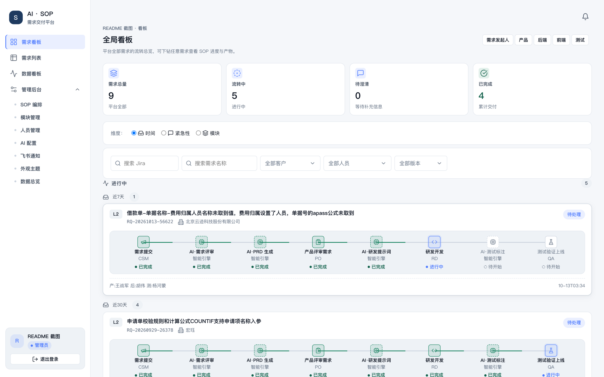
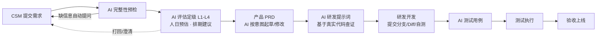
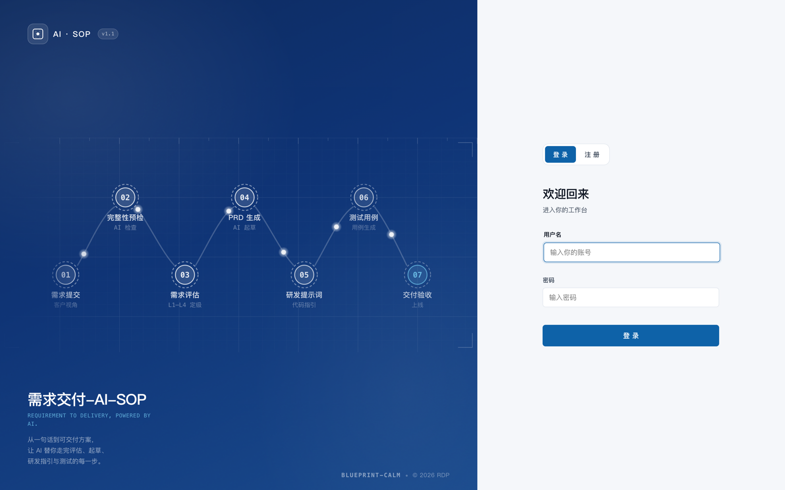
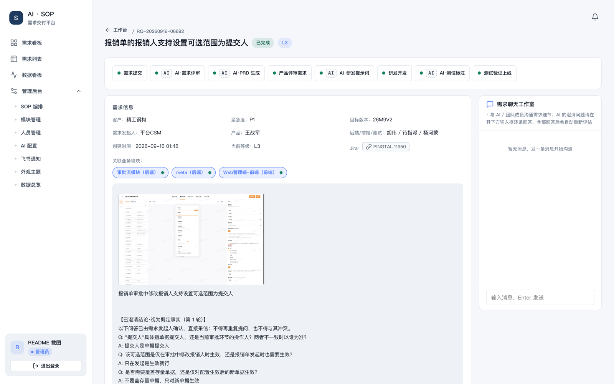
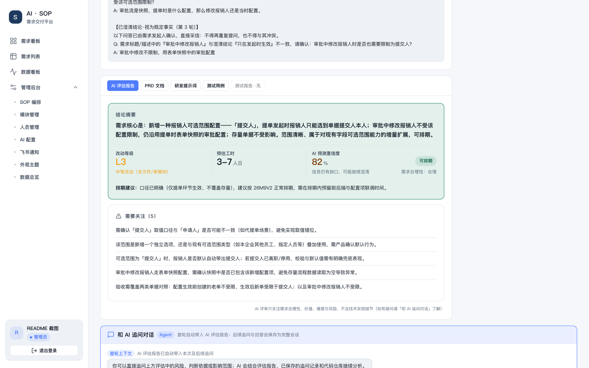
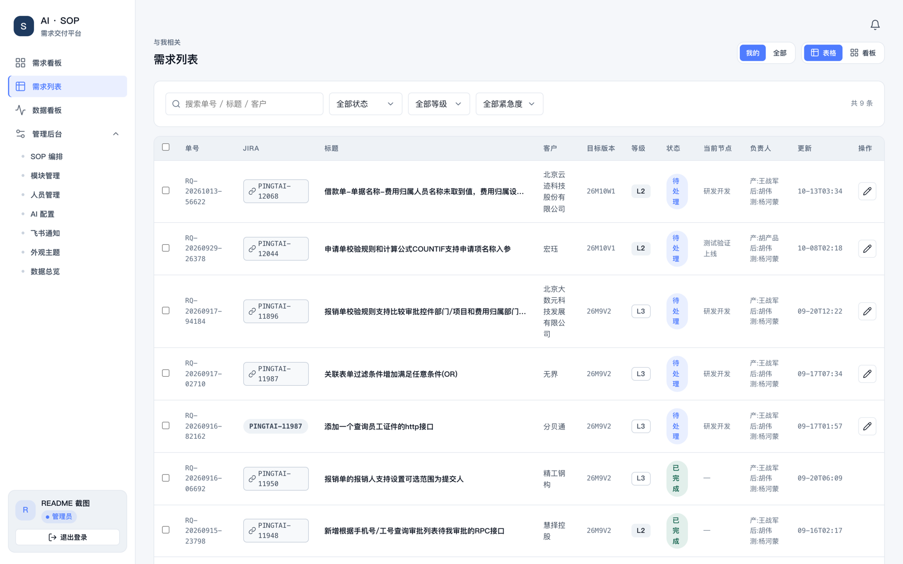
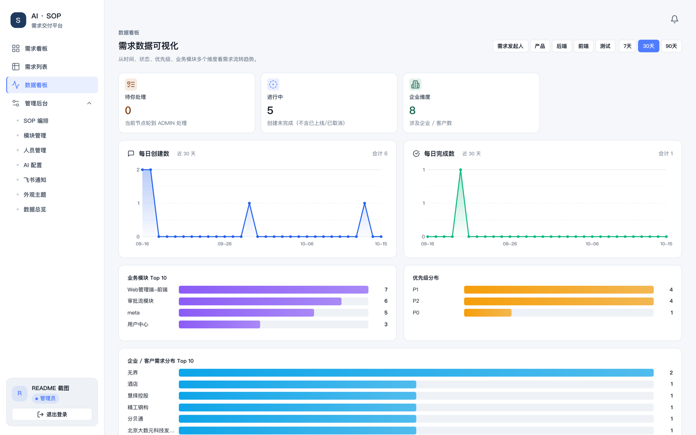
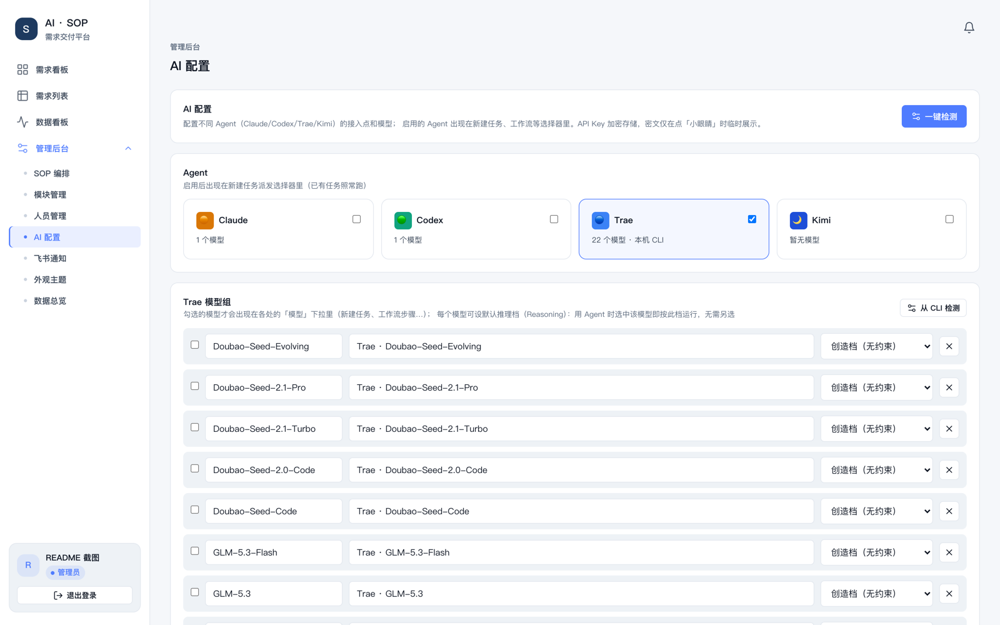
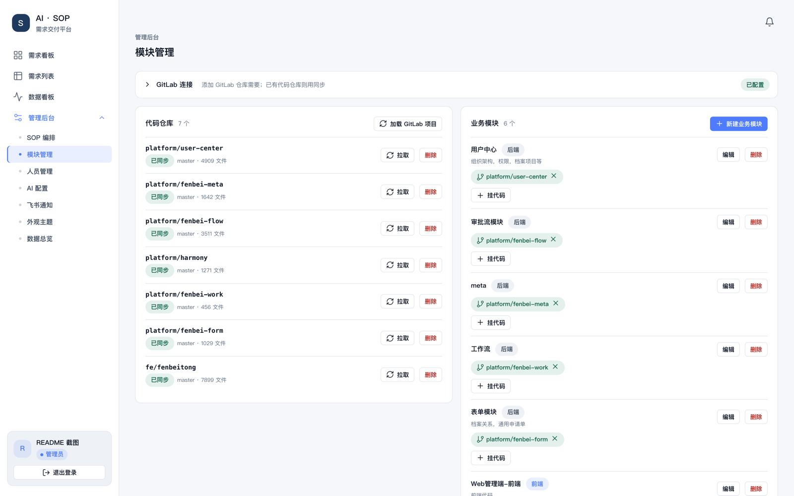

<div align="center">

# AI · SOP 需求交付平台

**把「提需求 → AI 评估 → PRD → 研发提示词 → 开发 → 测试 → 验收」整条交付链路，做成可配置、可追溯、AI 驱动的 SOP 流水线。**

[](https://nodejs.org)
[](https://react.dev)
[](https://www.typescriptlang.org)
[](https://expressjs.com)
[](https://www.mysql.com)
[](https://docs.docker.com/compose/)

[特性](#-核心特性) · [快速开始](#-快速开始) · [AI 配置](#-ai-provider) · [安全沙箱](#-安全与主机隔离) · [界面一览](#-界面一览) · [文档](#-更多文档)



</div>

---

## 它解决什么问题

客户需求从提出到上线，中间散落着评估、排期、PRD、研发、测试一堆环节——信息在聊天记录里丢失、结论没有依据、节点流转靠人盯。这个平台把交付过程**固化成 SOP 流水线**，并把 AI 嵌进每个关键节点：

- **AI 不是聊天挂件，而是节点执行者**：需求评估定级、PRD 起草、研发提示词、测试用例都由 AI 节点产出，且必须**基于真实代码证据**（AI 会自主检索关联仓库，引用文件路径与行号，禁止编造）；
- **每个角色有自己的驾驶舱**：CSM / 产品 / 研发 / 测试登录后看到各自的「待你处理」队列与看板，而不是所有人的同一张表；
- **全程留痕**：评估报告、PRD 版本、研发提示词、测试用例、打回原因、澄清问答、时间线——需求的一生都可回溯；
- **AI 被关在只读沙箱里**：模型只能读你在「模块管理」里同步进来的代码仓库快照，主机上的其他任何东西既不能看、也不能动（见 [安全与主机隔离](#-安全与主机隔离)）。

## 🧭 交付流水线



SOP 节点不是写死的：管理员可在后台**可视化编排**——增删节点、排序、绑定 AI 动作、配置节点提示词，流程跟着业务走。

## ✨ 核心特性

| 模块 | 能力 |
|---|---|
| **SOP 引擎** | 状态机由模板节点驱动；支持打回（必填原因）、澄清问答、强制提交；节点可视化编排 |
| **AI 节点** | 完整性预检 / 评估定级（L1-L4 + 人日 + 置信度）/ PRD 生成 / 研发提示词 / 测试用例；信息不足时自动向 CSM 提问挂起 |
| **AI 追问** | 在需求详情页与 AI 多轮对话，AI 实时检索代码仓库回答「这段逻辑在哪实现」 |
| **代码证据链** | 对接 GitLab 按模块同步仓库快照；AI 语义搜索（中文业务词→英文驼峰/下划线变体）+ grep + 窗口阅读，产物引用真实文件:行号 |
| **角色看板** | 每角色专属统计卡、待办队列、进行中列表；需求列表支持表格/看板双视图与多维筛选 |
| **集成** | Jira 单据创建与状态回写、飞书节点通知、多 AI Provider 热切换 |
| **数据看板** | 交付吞吐、节点耗时、AI 产物质量等统计 |
| **管理后台** | 人员与角色、SOP 编排、AI Provider、模块管理、飞书配置、主题定制、数据总览 |

## 🚀 快速开始

### Docker Compose（推荐）

```bash
cp .env.example .env
# 必填：DB_PASSWORD、MYSQL_ROOT_PASSWORD、SOP_MASTER_KEY、APP_BASE_URL
docker compose up -d --build
curl -fsS http://127.0.0.1:4000/api/health
```

完整的服务器部署、HTTPS、备份与恢复见 [`docs/docker-deploy.md`](docs/docker-deploy.md)。

### 本地开发

需要 MySQL 8，并按 [`server/.env.example`](server/.env.example) 创建 `server/.env`：

```bash
# 后端（端口 4000，同时托管前端静态产物）
cd server && npm install && npm start

# 前端开发模式（可选，端口 5173，代理到 4000）
cd web && npm install && npm run dev

# 生产构建 + 重启服务（macOS 本机用）
bash server/start.sh
```

打开 <http://localhost:4000>。首次体验可在 `server/` 下执行 `npm run seed` 生成各角色演示账号（生产环境请改密或禁用注册）。

### 主要环境变量

| 变量 | 必填 | 说明 |
|---|---|---|
| `DB_HOST` / `DB_PORT` / `DB_NAME` / `DB_USER` / `DB_PASSWORD` | ✅ | MySQL 连接（默认 127.0.0.1:3306） |
| `SOP_MASTER_KEY` | ✅ | 32 字节 base64 / 64 位 hex，加密 AI Key、口令等敏感数据；**首次生成后必须长期保留** |
| `MYSQL_ROOT_PASSWORD` | ✅* | Compose 内 MySQL root 密码（仅 Docker 部署） |
| `APP_BASE_URL` | ✅* | 对外访问地址（仅 Docker 部署） |
| `PORT` | | 服务端口，默认 4000 |
| `JIRA_DEFAULT_PROJECT_KEY` | | Jira 默认项目 Key |
| `MAX_ARCHIVE_MB` / `TAR_TIMEOUT_MS` / `GITLAB_TIMEOUT_MS` | | 仓库同步限额与超时 |

## 🤖 AI Provider

- 开箱即用**内置 Mock**：不配任何 Key 也能完整演示 SOP 流程（离线、结构化示例输出）；
- 管理后台支持 **Anthropic Claude / OpenAI 兼容协议**（Kimi、DeepSeek、GLM、通义…）与 **Trae CLI 本地进程**，多 Provider 热切换；
- 三级结构化输出降级：`json_schema` → `json_object` → `prompt_only` + Zod 出口校验，模型不听话也不会污染数据；
- 传输失败/限流自动重试与退避，全链路失败降级 Mock 并在产物 meta 里标记。

## 🔒 安全与主机隔离

这个平台会让 AI 读你的业务代码，因此 **AI 的手脚被限制在只读沙箱内**：

- AI 子进程统一经 macOS Seatbelt（`sandbox-exec`）启动：只能**只读**「模块管理」同步的仓库快照；主机家目录、`~/Library`、`/Volumes`、系统敏感目录一律不可见；**任何文件写入都被拒绝**；
- 子进程环境只携带 8 个良性变量——数据库密码、主密钥等服务器凭据**不会**进入 AI 进程；
- 禁止 `osascript` / `security` / Finder 自动化等主机探测与提权通道；网络仅放行 LLM API 出站（443/80/53）；
- 协议层双保险：AI 工具请求越权一律拒绝，读盘代理只认仓库快照内的路径（realpath 防符号链接逃逸）+ 敏感内容脱敏。

设计与威胁模型见 [`docs/sandbox.md`](docs/sandbox.md)，边界自检：

```bash
bash server/scripts/verify-sandbox.sh   # 19 项探针，任一 FAIL 即隔离被破坏
```

## 📸 界面一览

| | |
|---|---|
|  |  |
| **登录** —— 角色账号，自选注册 | **需求看板** —— 各角色专属待办与统计 |
|  |  |
| **需求详情** —— 节点流转、澄清问答 | **AI 产物留痕** —— 评估/PRD/研发提示词/测试用例 |
|  |  |
| **需求列表** —— 表格/看板双视图 | **数据看板** —— 交付吞吐与节点耗时 |
|  |  |
| **AI 配置** —— 多 Provider 热切换 | **模块管理** —— GitLab 仓库快照同步 |

## 🏗️ 架构

```
web/      React 18 + TypeScript + Vite（角色看板、SOP 编排、AI 产物视图）
server/   Express + MySQL 8
          ├─ engine.js        SOP 状态机与节点流转
          ├─ agent/           AI Agent 循环、代码检索工具、证据收集、ACP 客户端
          ├─ sandbox/         AI 子进程 Seatbelt 只读沙箱（主机隔离收口）
          ├─ repo/            GitLab 仓库快照同步、路径防逃逸、敏感文件脱敏
          ├─ llm/             Provider 管理、能力降级、连通性测试
          └─ services/        AI 任务调度、飞书通知、Jira 集成
deploy/   Nginx + 备份/恢复脚本（Docker Compose 编排）
```

## 📚 更多文档

| 文档 | 内容 |
|---|---|
| [`docs/sandbox.md`](docs/sandbox.md) | AI 沙箱设计与威胁模型 |
| [`docs/docker-deploy.md`](docs/docker-deploy.md) | 服务器部署、HTTPS、备份恢复 |
| [`docs/SPEC-v1.0.md`](docs/SPEC-v1.0.md) | 产品规格说明 |
| [`docs/openapi.yaml`](docs/openapi.yaml) | API 契约 |
| [`docs/decisions/`](docs/decisions) | 架构决策记录（ADR） |

---

<div align="center">

**AI · SOP 需求交付平台** —— 让每一次交付都有据可查。

</div>
